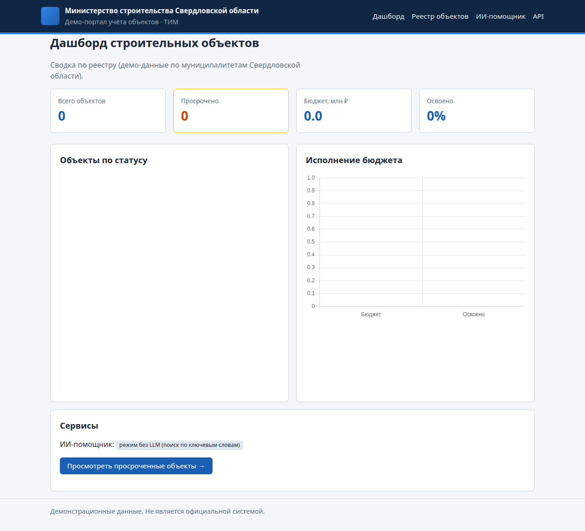
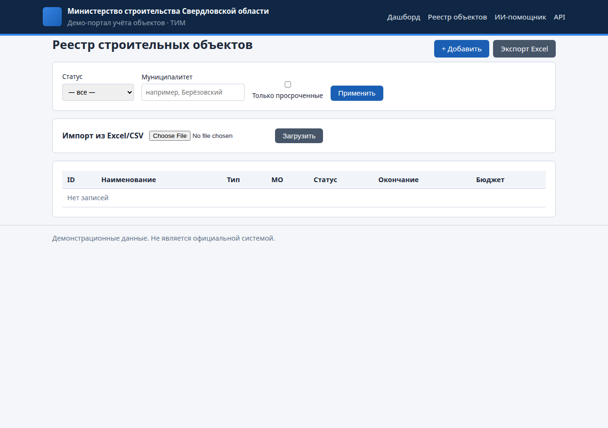
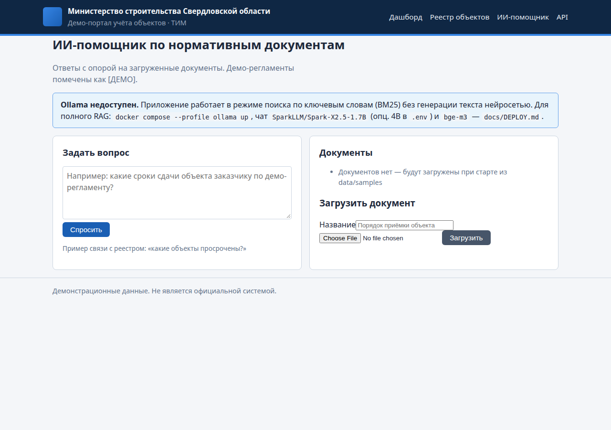
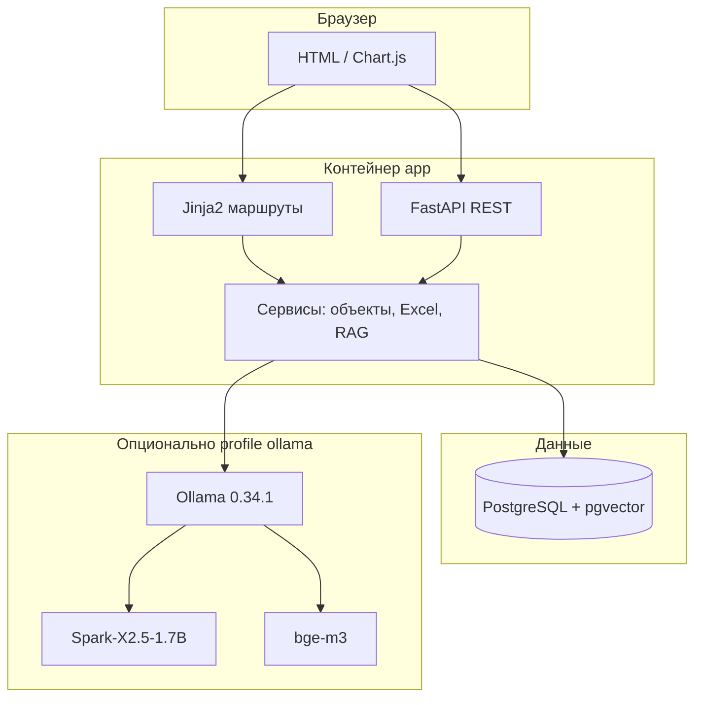

# Портал учёта строительных объектов + ИИ-помощник (демо)

Демонстрационный внутренний веб-сервис для портфолио: **реестр строительных объектов** Свердловской области и **RAG-помощник** по вымышленным нормативным документам. Стек близок к вакансии «Разработчик внутренних ИТ-сервисов (Python / AI / автоматизация)»: FastAPI, PostgreSQL, Docker, локальные LLM через Ollama, HTML/CSS/JS.

> Все организации, адреса и регламенты **вымышлены** и помечены как демо.

## Возможности

1. **Учёт объектов** — CRUD, фильтры (статус, МО, просрочка), история изменений, импорт/экспорт Excel, дашборд (Chart.js).
2. **ИИ-помощник** — загрузка PDF/DOCX/TXT, чанки + pgvector; локальный чат **Spark-X2.5-1.7B** (опционально **4B** через `.env`) и **bge-m3**; fallback BM25.

## Скриншоты

| Дашборд | Реестр | Помощник |
|---------|--------|----------|
|  |  |  |

## Быстрый старт

```bash
cp .env.example .env
docker compose up -d --build
# опционально LLM:
docker compose --profile ollama up -d
docker compose exec ollama ollama pull bge-m3
docker compose exec ollama ollama pull SparkLLM/Spark-X2.5-1.7B
# опционально тяжелее: SparkLLM/Spark-X2.5-4B
```

Открыть: [http://localhost:8000](http://localhost:8000) · API: [http://localhost:8000/docs](http://localhost:8000/docs)

Развёртывание на VDS (nginx, HTTPS, RAM): **[docs/DEPLOY.md](docs/DEPLOY.md)**.

## Архитектура



## Технологии и зачем

| Технология | Причина выбора |
|------------|----------------|
| **FastAPI** | Async API, автодокументация OpenAPI, типизация |
| **PostgreSQL + pgvector** | Один сервер БД для объектов и эмбеддингов |
| **Alembic** | Версионирование схемы |
| **Jinja2 + CSS** | Простой серверный UI без тяжёлого фронта |
| **pandas / openpyxl** | Привычный обмен с Excel в госсекторе |
| **Ollama + Spark / bge-m3** | Локальные модели на CPU-VDS, без облачных API |
| **BM25-fallback** | Демо работает без моделей |

## Разработка

```bash
python -m venv .venv && source .venv/bin/activate
pip install -r requirements.txt
# PostgreSQL с pgvector локально или docker compose up db
alembic upgrade head && python scripts/seed.py
uvicorn app.main:app --reload
ruff check .
pytest -q
```

## Что улучшить дальше

- Авторизация (SSO / Keycloak), роли куратор/руководитель.
- Фоновая переиндексация документов (Celery / ARQ).
- Полнотекстовый поиск PostgreSQL + гибрид с векторами.
- Уведомления о просрочке (e-mail / Telegram внутренний бот).

## Собеседование

Пошаговое объяснение кода и типовые вопросы: **[docs/INTERVIEW.md](docs/INTERVIEW.md)**.
